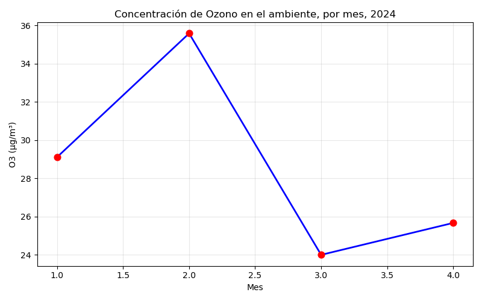

# luca-bitacora-personal
# 📓 Bitácora de Ciencia de Datos

**Luca Sonneveld** · Introducción a la Ciencia de Datos · Universidad de Montevideo — FCEE · 2026


Repositorio personal del curso. Acá queda registrado, clase a clase, lo que fui trabajando:
desde armar la primera tabla hasta limpiar datos reales de tránsito y calidad del aire de
Montevideo, graficarlos y ajustar un primer modelo.

---

## 🗂️ Contenido

| # | Clase | Tema | Qué hay |
|:-:|:-----:|------|---------|
| 01 | Clase 1 | [**Objetos**](01_objetos/) — la primera tabla | Describir 9 objetos en un diccionario y pasarlo a un DataFrame |
| 02 | Clase 2 | [**Conteo de tránsito**](02_conteo-transito/) — leer y filtrar | Filtros por avenida, fecha y volumen sobre los conteos de agosto 2026 |
| 03 | Clase 3 | [**Preguntas de la clase 3**](03_preguntas-clase3/) | Respuestas al cuestionario de la clase |
| 04 | 17/09 | [**Ozono 2024**](04_ozono/) — carga y transformación | Limpieza de datos (codificación, faltantes, duplicados) y dos gráficos |
| 05 | Clase 10 | [**Tránsito y calidad del aire**](05_transito-y-aire/) | Faltantes, hora pico, PM2.5 por franja y un modelo de NO2 |
| 06 | 27/10 | [**Unir tablas**](06_unir-tablas/) — *left* e *inner join* | Ejercicios 58 a 61, en papel |

Cada carpeta tiene su propio README con el detalle de lo que se hizo.

---

## 📈 Un vistazo

Concentración de ozono por mes (enero a abril 2024), de la clase 04:



---

## 🧱 Estructura

```
.
├── 01_objetos/
├── 02_conteo-transito/
├── 03_preguntas-clase3/
├── 04_ozono/
│   └── figuras/
├── 05_transito-y-aire/
├── 06_unir-tablas/
├── Historial/          ← archivos como estaban antes de ordenar
├── requirements.txt
└── .gitignore
```

---

## ▶️ Cómo correr los scripts

```bash
pip install -r requirements.txt
python 04_ozono/carga_y_transformacion.py
```

Los datos **no se suben** al repositorio: por regla del curso, los datos crudos y lo que se puede
regenerar no se versionan (ver `.gitignore`). Para correr un script, poné su CSV en la misma
carpeta que el script:

| Script | CSV que necesita |
|--------|------------------|
| `02_conteo-transito/analisis_conteo.py` | `Conteo_Agosto_2026.csv` |
| `04_ozono/carga_y_transformacion.py` | `o3_01_2024_04_2024.csv` |
| `05_transito-y-aire/ejercicios_1_a_4.py` | `transito_aire_junio2024.csv` |

---

## 🕓 Historial

La carpeta [`Historial/`](Historial/) guarda los archivos tal como estaban antes de ordenar la
bitácora. La versión ordenada es la de las carpetas 01 a 06.
